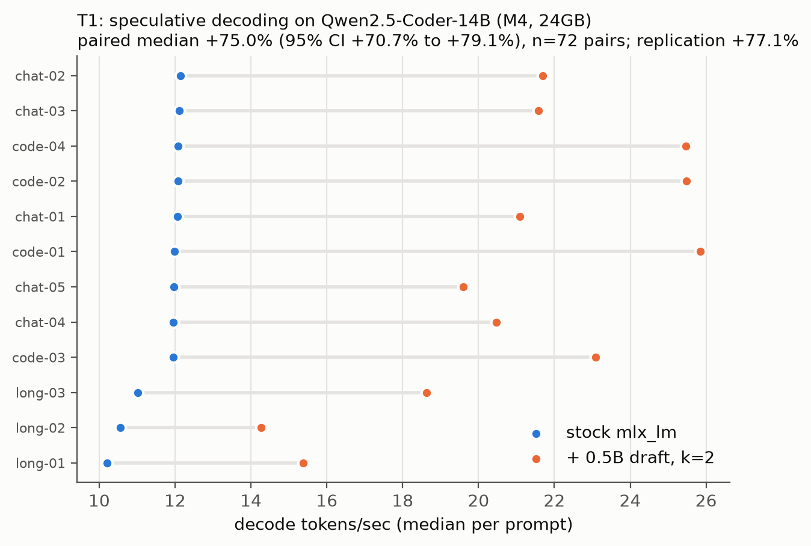
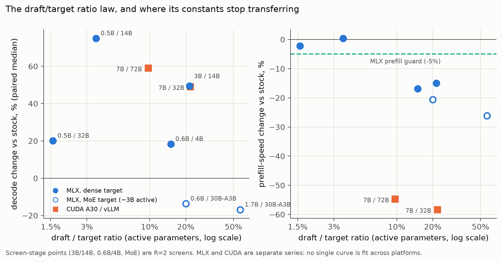
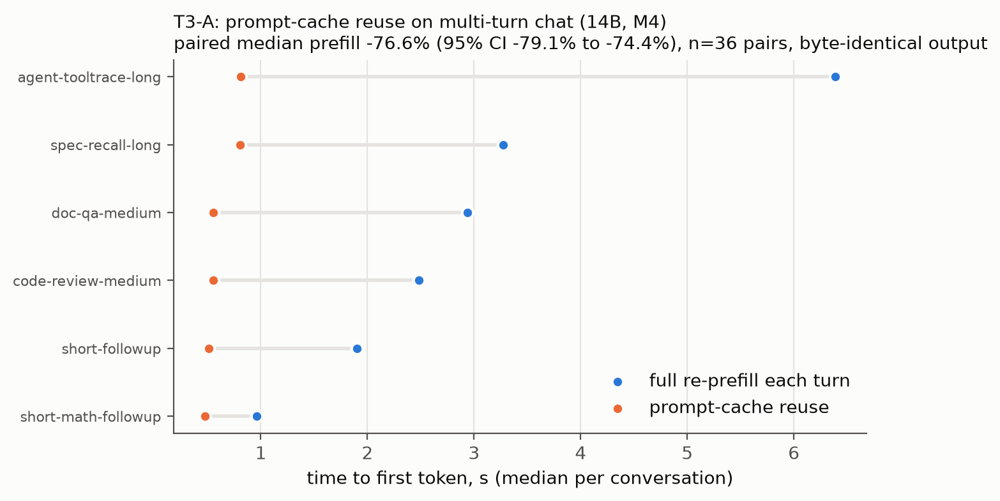
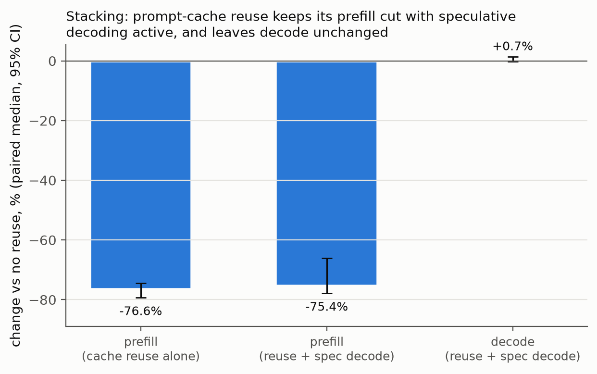
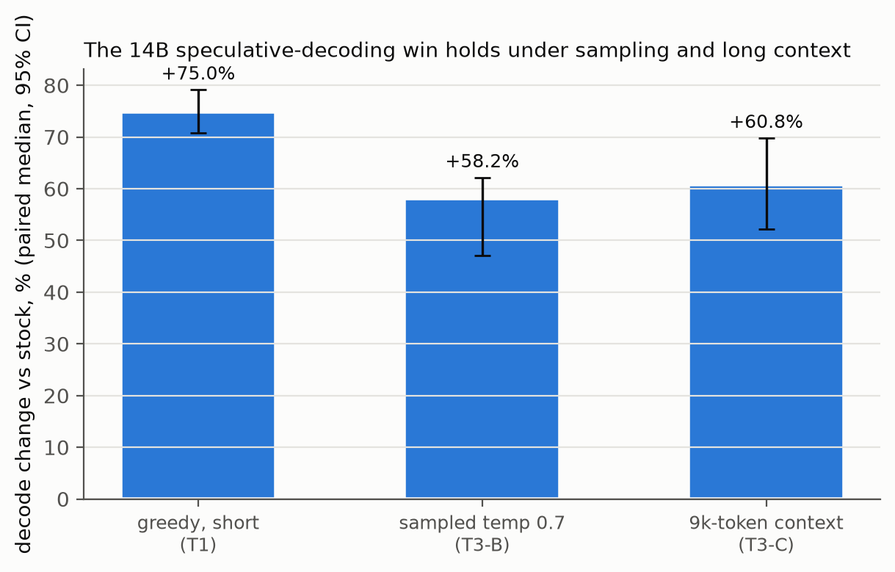
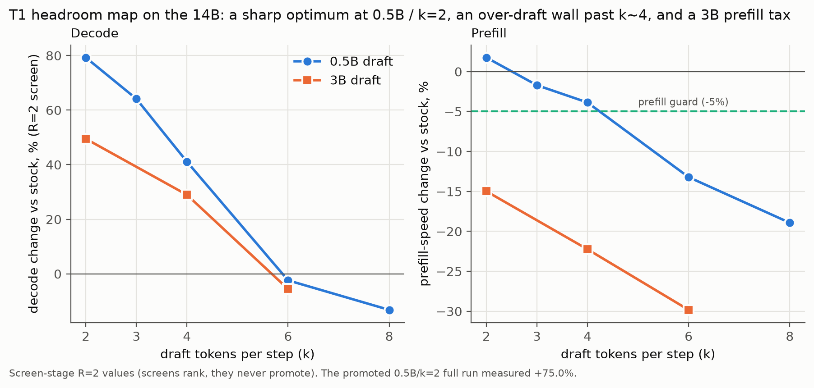
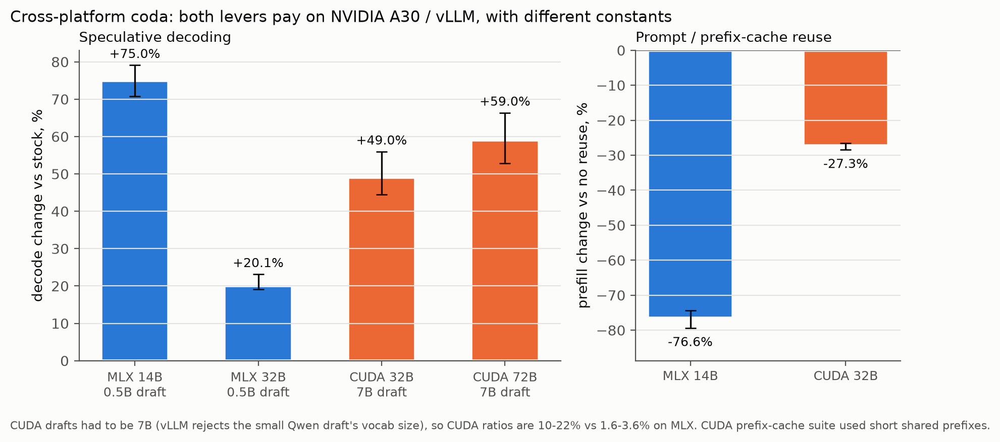

# Speculative Decoding Pays Only at Small Active-Parameter Ratios on Apple Silicon: A Pre-Registered Headroom Map for Local LLM Inference

## Abstract

How much faster can local LLM inference get on commodity hardware at verifiable quality parity? I built Hone, a measurement machine that answers that question under one pre-registered protocol. Before I judged any comparison, I set margins from identical-vs-identical noise floors. Every promotion gate is mechanical. The gates are the paired sign test over discordant pairs, a prefill guard, quality parity for the technique class, run integrity checks, and a separate-session replication. Speculative decoding on a Qwen2.5-Coder-14B target with a 0.5B draft at two draft tokens yielded +75.0% median paired decode throughput (p = 4.2e-22, replicated at +77.1%). Output quality fell in the near-tie-flip class. Speculative decoding pays when the draft step time is a small fraction of the target step time, set by active parameters, not total parameter count. Prompt-cache reuse cut multi-turn prefill -76.6% losslessly. Under every draft configuration, a mixture-of-experts target lost decode. That finding sharpened the ratio law. On a dense 32B target the same method yielded +20.06% (p = 7.3e-14, replicated at +20.2%). The decode win survived sampling (+58.2%) and long context (+60.8%). I also ran a cross-platform check on NVIDIA A30 GPUs. It confirmed the levers transfer while the tuning constants do not. The full headroom map, spanning the negative results, is the deliverable.

## 1. Introduction

A 14-billion-parameter coding model decodes at 11.88 tokens per second out of the box on an M4 Mac mini (24GB). That is fast enough to read but not fast enough to feel instant inside an agent loop that makes many calls per task. Local LLM inference is useful but slow.

Speculative decoding, prompt-cache reuse, and other configuration-level knobs are public knowledge. The open question is not whether they exist. It is how much they actually deliver on particular hardware, under what conditions, at what quality cost, and whether the measurement itself can be trusted. A number without a registered margin is a number without a denominator.

I built Hone to create an honest headroom map and wrapped a pluggable set of target modules inside a pre-registered measurement protocol. Each module is specified by a metric, a frozen suite, a quality gate, and a search space. I required identical-vs-identical calibrations before judging any comparison, cause-based voiding of contaminated segments, and a conjunctive promotion gate with no human judgment inside. I registered the null hypothesis before the first trial. It was that tuned configuration buys less than a small multiple of median decode speedup at quality parity. The rest of this article reports what worked, what did not, and why the protocol had to amend itself along the way.

## 2. System and Method

### 2.1 Hardware

I ran all primary measurements on two boxes.

- An M4 Mac mini (24GB), running mlx 0.32.0, mlx-lm 0.31.3, and Python 3.14.3, with the stack versions pinned exactly.
- An M3 Ultra Mac Studio (96GB), re-calibrated from scratch under the per-box law.

I ran a cross-platform check on NVIDIA A30 GPUs. Section 6 reports those findings separately.

### 2.2 Models and suites

The primary target was Qwen2.5-Coder-14B-Instruct-4bit, the model I ran daily. Speculative-decoding drafts were Qwen2.5-0.5B-Instruct-4bit, Qwen2.5-Coder-3B-Instruct-4bit, and Qwen3-0.6B-4bit. The small-class target was Qwen3-4B. On the second box the targets were Qwen3-Coder-30B-A3B (a mixture-of-experts model with roughly 3B active parameters) and Qwen2.5-Coder-32B (dense).

I froze and content-hashed each prompt suite before any timed run. The primary suite comprised chat, code-generation, and long-context prompts at fixed max tokens, all greedy. One separate frozen suite of roughly 9k-token-context prompts served the long-context module.

### 2.3 Target modules

A target module is specified by { benchmark suite, pinned baseline, quality gate, search space, noise model }. Adding a target means shipping all five, hashed, before any tuning run against it.

- T1 decode: (greedy short-context decode tokens per second). The first module, run on both boxes.
- T3-A prefill: The metric is prefill time in seconds, recorded directly, not obtained from throughput (time-to-first-token for multi-turn prompt-cache reuse).
- T3-B sampled decode: (decode tokens per second at temperature > 0). The byte-compare quality gate does not apply here. The registered gate is distribution preservation, a proven property of speculative sampling.
- T3-C long-context decode: (decode tokens per second at roughly 9k tokens of context). Same greedy byte-compare gate as T1.

### 2.4 Search space

Candidates are configuration JSON, which I validated against a whitelist of knobs. Candidates never supply code. The knobs are draft model, number of draft tokens, KV-cache quantization bits and group size, prefill step size, and wired-memory limit. Unknown keys produce a hard error.

## 3. Measurement Protocol and Gates

### 3.1 Paired interleaved A/B

I ran every timed comparison as a paired interleaved design and discarded repetition 0 of every arm as warmup, a rule I registered before the first run. Promotion runs use R = 6 scored repetitions plus one warmup, giving 72 pairs on a 12-prompt suite. The pair key is (prompt, repetition). Repetition r runs arms in order (A, B) for even r and (B, A) for odd r, giving ABBA drift cancellation. A timed segment is one runner subprocess pass over the full suite for one arm.

### 3.2 A/A' noise floors and registered margins

I ran identical-vs-identical (A/A') calibrations and measured the paired noise floor before any candidate was judged. The promotion floor of 1.10x binds on both models, with a prefill and wall-clock allowance of 5%. On the M4 Mac mini (24GB) I measured Qwen3-4B MAD 1.16% and Qwen2.5-Coder-14B MAD 0.76%, both from R = 6 with n = 72 pairs, contamination-clean.

On the M3 Ultra Mac Studio (96GB) I measured 30B-A3B MAD 1.7% and dense-32B MAD 0.16%. Both were byte-stable, and both bind on the 1.10x speed floor and 5% prefill allowance.

Greedy decode is byte-stable run-to-run on this stack, with 42/42 clean segments across the three runs, both models on the first box. The lossless quality gate is therefore a hard byte-compare.

I froze margins in the pre-registered protocol as append-only amendments, each written before the findings it governs, and judged nothing below before its margins were registered.

### 3.3 The sign test and discordant pairs

I judged verdicts with the exact sign test over discordant pairs and registered the minimum discordant pair count in advance. Anything under that threshold is classified as underpowered and excluded, never counted as negative.

### 3.4 Promotion gates G1-G5

The five gates follow. Promotion is conjunctive and mechanical, with no human judgment inside.

- **G1** -- decode speedup at or above the registered margin, paired.
- **G2** -- prefill and suite wall-clock not worse beyond the registered allowance.
- **G3** -- quality parity for the technique class (lossless: byte-identical output. Near-tie-flip: diverged prompts within a registered maximum share of the suite, each arm individually byte-stable across all reps, stop-reason distribution unshifted, and the exact-token divergence-probe report attached. Lossy: score parity on a frozen benchmark within a registered margin. The lossy-class gate does not exist yet. Building it was registered as a precondition.)
- **G4** -- integrity. All hashes match, lock held, guards green, token recounts and wall-clock sanity pass, contamination check clean.
- **G5** -- replicates in a separate session under a different contention regime.

### 3.5 Cause-based voiding

Voiding a segment because its throughput looks slow is outcome selection and biases the noise floor down. It is forbidden. I voided segments only for cause, which means a box-quiet probe that fails after the segment, a thermal-state change during the segment, or a recount/wall-clock sanity failure.

### 3.6 Contamination checks

A contamination check flags any segment whose suite-median decode throughput deviates more than 15% from the arm's own grand median. The check is per-arm, not pooled, because a legitimately faster candidate would deviate from the pooled median by design. I backtested the 15% band. Contaminated segments from an early invalid run differed far outside the band. Clean ambient wobble stayed well within it.

### 3.7 The screening law

Candidate ranking may use paired R = 2 screening runs. Screening produces no wins and no reportable speedups. It only selects candidates for full R = 6 promotion runs. Every screen-stage value in this inquiry is a ranking value, not a promotion-grade finding.

### 3.8 Anti-gaming guards

In every run header, I recorded runner and harness file hashes, and a mismatch voids the run. Canary tests run before every promotion. In them, corrupted output must fail parity, forged token counts must fail the recount, forged throughput must fail wall-clock sanity, an unknown config knob must hard-error, and an edited suite must change the suite hash. Each canary asserts the gate fails, and every new assertion fails once on purpose before it is trusted.

The token recount defense re-tokenizes the captured output, so a run that silently generates fewer tokens is caught by the recount. Also, a run whose throughput claim is inconsistent with its subprocess wall-clock is voided.

### 3.9 Amendments born from incidents

The protocol caught its own rules being wrong three times during calibration.

- A1: The first A/A' run was invalid. Contention from processes that did not take the GPU lock arrived mid-segment, after the start-of-segment guard had passed. I added a post-segment box-quiet probe that voids any segment where contention arrived during the measurement.
- A2: A memory-pressure guard deferred dozens of consecutive times on an otherwise idle box, because it measured cache warmth, not risk. I replaced the threshold so the guard triggers on load spikes, not ambient memory states.
- A3: A sanity rule compared single-pair extremes against median-scale margins, a scale mismatch that caused it to fire on clean data. My replacement rule adopts per-segment suite-median deviations, and I backtested it on data already in hand before registration.

The amendments are append-only, dated and written before the findings they regulate. Each fix shipped with a canary test that failed once against the unpatched code and was backtested on data already in hand.

## 4. Results

### 4.1 T1: speculative decoding on 14B (M4 Mac mini, 24GB)

Greedy, frozen 12-prompt suite. Target: Qwen2.5-Coder-14B-Instruct-4bit, baseline 11.88 tokens/sec median decode.

The 0.5B draft was screened at num_draft_tokens = {2, 3, 4, 6, 8} and the 3B draft at {2, 4, 6}. The 3B draft failed the prefill guard everywhere (prefill -15.0% to -29.8%), and the 0.5B draft at k = 2 ranked highest at the screen stage. Both drafts lost decode outright at k = 6 and above.

The headroom map follows. Screen-stage values are R = 2 ranking, not promotion results.

| Candidate | Screen R=2 | Full R=6 | Prefill | Verdict |
|---|---|---|---|---|
| 0.5B draft, k=2 | +79.3% | **+75.0% (p=4.2e-22)** | +0.4% | **PROMOTED** |
| 0.5B draft, k=3 | +64.1% | +62.7% (p=4.2e-22) | -3.1% | passes gates, dominated by k=2 |
| 0.5B draft, k=4 | +41.1% | -- | -3.9% | screened out |
| 0.5B draft, k=6 | -2.4% | -- | -13.2% | over-draft wall |
| 0.5B draft, k=8 | -13.2% | -- | -18.9% | over-draft wall |
| 3B draft, k=2 | +49.5% | -- | -15.0% | draft prefill tax fails guard |
| 3B draft, k=4 | +28.9% | -- | -22.2% | draft prefill tax fails guard |
| 3B draft, k=6 | -5.6% | -- | -29.8% | prefill tax + over-draft |

The full R = 6 promotion run on the 0.5B draft at k = 2 gave all these findings (Figure 1).

- **Decode: 11.88 to 21.04 tokens/sec median (+75.0%)**, paired over 72 pairs, sign test p = 4.2e-22, all 72 pairs positive.
- Suite wall-clock -29.4%. Prefill +0.4%.
- **Quality: near-tie-flip class, NOT byte-exact** (A5 policy). 10/12 prompts byte-identical across all reps. 2/12 diverge deterministically at one token each. The exact-token-prefix probe measures the top-2 gap at those positions at 0.016 nats. Clear-cut control positions measure 4.3-13.5 nats. The mechanism is batched-verification fp16 numerics flipping genuine coin-flip argmaxes onto alternate model-sanctioned greedy paths. Both arms individually byte-stable. Stop-reason distribution unshifted.
- G5 replication: ran in a separate session roughly 14 hours later, under a different contention regime. It gave **+77.1%** (p = 4.2e-22), prefill +0.2%, and a matching divergence signature, with the same two prompts, the same token indices and the same 0.016-nat gaps, deterministic across days.

*Figure 1. Per-prompt dumbbell plot of T1 speculative-decoding results on Qwen2.5-Coder-14B, M4 Mac mini (24GB). Each dot pair shows the per-prompt median decode throughput for the "stock mlx_lm" arm and the "+ 0.5B draft, k=2" arm, across 72 paired observations. The figure title displays a bootstrap confidence interval computed by the figure-generation script from the raw evidence, not reported in the text of this paper.*

I later found another job had run unserialized during the primary run's window. The post-segment guard voided and re-ran two segment attempts during that window. The guards judge box state, not the lock, by design. My per-segment audit found all 12 scored segments within +-7% of their arm median.

**The headroom map.** The negative findings are findings. The 0.5B draft at k = 4 ranked at +41.1% at the screen stage but was dominated. At k = 6 the screen showed -2.4%, and at k = 8 it showed -13.2%. The 3B draft at k = 2 screened at +49.5% decode but failed the prefill guard at -15.0%. At k = 4 it screened at +28.9% with -22.2% prefill, and at k = 6 it screened at -5.6% with -29.8% prefill. All screen-stage values are R = 2 ranking values, not promotion results.

### 4.2 Wave 2: interactions versus the champion -- all null or worse

Every one was null or negative. I tested several revisions on top of the promoted champion.

- Prefill step size 512 and 4096: +0.1% and +0.3% decode versus the champion, indistinguishable from noise, byte-identical output.
- Champion plus KV quantization at 4 bits: -24.5% decode, prefill -12.3%.
- KV quantization at 8 bits without a draft (against the champion, not against plain baseline): -44.3%.
- Champion plus KV quantization at 8 bits: roughly -10% where it ran, then faulted Metal on the second long-context prompt. Short-context runs were clean.
- Champion plus wired-memory limit at 18 GB: invalid configuration, rejected because the limit exceeded the maximum working set on the 24 GB box.

Wave 1 was a one-dimensional grid with a sharp optimum at k = 2. Wave 2 showed nothing stacks on the champion. The pre-registered exit rule for the automated search loop (P2) needed a combinatorial surface. There was none, so I declined to build it.

### 4.3 Wave 3: cross-class check on the 4B -- no promotable configuration

Qwen3-4B target with the smallest in-family compatible draft (Qwen3-0.6B-4bit). At k = 2 the screen-stage decode was +18.4% (p = 0.0015, clears the speed margin). Despite this, prefill was -16.9% (guard fail). At k = 3 the screen-stage decode was +10.5% (margin fail), with prefill -17.8%. The draft-prefill tax that disqualified the 3B draft on the 14B is fatal on the small class. The spec-decode win is specific to large-target / tiny-draft ratios. 0.5B/14B at 3.5% of target size works, while 0.6B/4B at 15% and 3B/14B at 21% both fail the guard.

### 4.4 T2: larger targets on the M3 Ultra Mac Studio (96GB)

#### The mixture-of-experts negative

Target: Qwen3-Coder-30B-A3B (roughly 3B active parameters), baseline roughly 105 tps decode. I screened the 0.6B and 1.7B drafts at k = {2, 3}. Every one lost decode. All values in the table are R = 2 screen-stage ranking.

| Candidate | Decode | Prefill | Verdict |
|---|---|---|---|
| 0.6B k=2 | -13.6% | -20.6% | negative |
| 0.6B k=3 | -22.4% | -24.5% | negative |
| 1.7B k=2 | -16.9% | -26.1% | negative |
| 1.7B k=3 | -21.9% | -30.0% | negative |

Draft acceptance was healthy (median 0.47-0.50 of tokens came from the draft), yet decode still lost. The draft-plus-verify cycle costs more than a target step that is already roughly 9.5 ms on 3B active parameters. This is the MoE negative that sharpened the ratio law into its real form (Figure 2).

**The ratio law (active-parameter step-time form).** Speculative decoding pays when the draft's per-step time is a small fraction of the target's per-step time, set by active parameters and box speed, not total parameter count. A 0.6B draft against roughly 3B active is a 20% effective ratio, which fails just like the 15-21% ratios on smaller targets. The "fraction of total parameters" framing predicted a win and was wrong. MoE speculative decoding is also not the near-tie-flip quality class, and shows real byte mismatches and a shifted stop-reason distribution.

*Figure 2. The draft/target ratio law. Left: decode-speed change versus stock. Right: prefill-speed change. Circles are MLX results (filled = dense target, hollow = MoE target with approximately 3B active parameters). Squares are NVIDIA A30 / vLLM results. Screen-stage points (3B/14B, 0.6B/4B, MoE rows) are R = 2 ranking values, not promotion results. The two platforms form separate series, and no single curve is fit across them.*

#### Dense 32B -- promoted

Target: Qwen2.5-Coder-32B (dense, active = total), baseline 34.7 tps. The 0.5B draft at k = 2 cleared the screen (+19.8% ranking). On the prefill guard, the 0.5B at k = 3 fell out.

- **Decode: 34.7 to 41.7 tps (+20.06%)**, 66/72 pairs positive, sign test p = 7.3e-14, prefill -2.2% (within the allowance), suite wall -11%.
- **Quality: near-tie-flip class.** 8/12 prompts byte-identical. 4 diverge deterministically at top-2 gaps of 0.0-0.016 nats, both arms byte-stable, stop reasons equivalent.
- Replicated: in an independent session at +20.2% (p = 7.3e-14), same 4 divergence positions, same gaps.

The +20.06% on the 32B is smaller than the +75.0% on the 14B. That is the ratio law being consistent. The dense-32B target step leaves less headroom for the draft to hide under than the 14B target step does.

### 4.5 T3-A: prompt-cache reuse for multi-turn / agent loops -- promoted, lossless

Agent loops re-send a large shared prefix every turn. Their cost is prefill, not decode. The candidate keeps a persistent KV cache and prefills only the new tokens. The baseline re-prefills the whole conversation every turn. Two arms, greedy 14B on the M4 Mac mini (24GB), no draft, separating the cache effect. I measured time-to-first-token directly.

- Prefill -76.6% median: A full-prefill turn is roughly 2.8 s, and reuse cuts it to roughly 0.6 s. 36/36 pairs favor cache, p = 2.9e-11, replicated across two sessions. The range was -50% to -87% (Figure 3), about 2.15 s saved per turn.
- **Lossless: byte-identical output, 0 mismatches.** Cache reuse is the same KV computation, not an approximation. Before trusting it, I validated it token-for-token with a small-model probe. Decode unchanged.
- The saving scales with prefix length. The longer the re-sent context, the larger the win.

*Figure 3. Per-conversation dumbbell plot of T3-A prompt-cache reuse on multi-turn chat, 14B, M4 Mac mini (24GB). Each dot pair shows the per-conversation median time-to-first-token for the "full re-prefill each turn" arm and the "prompt-cache reuse" arm. Output is byte-identical between arms. The figure title displays a bootstrap confidence interval computed by the figure-generation script from the raw evidence, not reported in the text of this paper.*

### 4.6 T3-B: does the speed win survive sampling? -- yes, +58.2%

Everything above is greedy. I re-ran the 14B champion at temperature 0.7, seed-matched per prompt (I confirmed first that seeded sampling is reproducible on this stack).

- Decode +58.2% (72/72 pairs, p = 4.2e-22). The win survives, smaller than greedy's +75.0%.
- Why smaller: the speedup scales with acceptance, and acceptance drops as temperature rises. Draft acceptance falls to a median 0.49 at temp 0.7.
- At temperature > 0 the byte-compare gate does not apply. Each arm is per-seed reproducible. Speculative sampling provides distribution preservation by construction.

### 4.7 T3-C: does it hold at long context? -- yes, +60.8%

Greedy 14B, a frozen 4-item suite of roughly 9.4k-token contexts. At roughly 9k tokens of context the target's attention cost per token rises and the draft must carry the full context.

- Decode +60.8% (24/24 pairs, p = 1.2e-7), byte-lossless (0 mismatches).
- Prefill -4.3% (the 0.5B re-reading 9k tokens), within allowance.
- The decode speedup pays most on long generations, less when a big prefix dwarfs a short reply. At long context, prefill dominates the total wall, so suite wall improves only -3.1% even with decode +60.8%.

### 4.8 Stacking

With the speculative draft active, prompt-cache reuse still cuts prefill -75.4% losslessly (36/36 paired, p = 2.9e-11). Decode is unchanged (Figure 4). The two levers address different costs (cache reuse addresses prefill, speculation addresses decode), so a multi-turn agent loop gets both at once.

*Figure 4. Stacking. Prompt-cache reuse keeps its prefill cut with speculative decoding active, and leaves decode unchanged. The left bar is cache reuse alone, from the T3-A run with no draft. The middle and right bars come from the stacking run, where both arms had the speculative draft active, so it measures the effect of cache reuse with speculation on. Error bars are bootstrap confidence intervals computed by the figure-generation script from the raw evidence, not reported in the text of this paper.*

### 4.9 Where this leaves the champion

The 14B speculative-decode configuration holds across every regime I tested, greedy short +75.0%, sampled +58.2%, long-context +60.8% (Figure 5), and a separate, orthogonal lever, prompt-cache reuse, cuts multi-turn prefill -76.6% losslessly. The two combine, as measured directly in the stacking run.

*Figure 5. The 14B speculative-decoding win across three regimes, which are greedy short-context (T1), sampled at temperature 0.7 (T3-B), and long context at approximately 9k tokens (T3-C). Error bars are bootstrap confidence intervals computed by the figure-generation script from the raw evidence. Those intervals are not reported in the text of this paper.*

## 5. Negative Results and Walls

### 5.1 The over-draft wall

Both drafts lost decode outright on the 14B at k = 6 and above, and the 3B draft at k = 6 screened at -5.6%. The 0.5B draft at k = 6 screened at -2.4% decode and at k = 8 at -13.2%. At k = 2 the 0.5B is the clear optimum, k = 3 passes gates but is dominated by k = 2, and k = 4 was screened out.

### 5.2 The draft-prefill tax

A larger draft model pays a prompt-processing cost. The 3B draft on the 14B target showed prefill regressions of -15.0% to -29.8% across all k values, failing the 5% prefill guard everywhere. The 0.6B draft on the 4B target showed -16.9% to -17.8%, also failing the guard, and the draft-prefill tax is the binding restriction for all these setups.

*Figure 6. The T1 headroom map on the 14B (R = 2 screens). Left: decode-speed change versus stock as the draft length k grows, for the 0.5B and 3B drafts. Right: prefill-speed change, with the 5% prefill guard dashed. The 0.5B draft peaks at k = 2 and falls through the over-draft wall by k = 6. The 3B draft fails the prefill guard at every k. Screens rank candidates and never promote them.*

### 5.3 MoE speculative decoding

Every draft configuration lost decode on the MoE target despite healthy draft acceptance. When the target step is already fast on a small active parameter count, the draft-plus-verify cycle is too expensive. The qualitative shape of the ratio law holds (smaller draft/target ratios are better), but the MoE result proved that "total parameter count" is the wrong denominator.

### 5.4 KV-cache quantization

KV quantization at 4 bits on top of the champion cost -24.5% decode and -12.3% prefill. KV quantization at 8 bits without a draft measured -44.3% versus the champion, equal to the plain baseline. KV quantization is a memory knob, not a speed knob on this hardware. The lossy-class quality gate that KV-quantized promotions would need does not exist yet, and building it was registered as a precondition.

### 5.5 The P2 search loop

I declined the planned self-tuning search loop per the pre-registered exit rule. Wave 1 was a one-dimensional grid with a sharp optimum. Wave 2 showed nothing stacks on it. If the grid saturates the headroom, an automated search loop is theater.

### 5.6 The small-class negative

The spec-decode win is particular to large-target / tiny-draft ratios. The smallest compatible draft (0.6B, at 15% of target size) fails the prefill guard. No promotable speculative-decoding configuration exists for the 4B target on the M4 Mac mini (24GB).

## 6. Cross-Platform Coda: NVIDIA A30 / vLLM

I report no noise floors, margins, or sign tests for this platform, so I provide it as a completing check, not a gated promotion. As a completing check I re-ran the two promoted levers on NVIDIA A30 GPUs via vLLM, which has speculative decoding and automatic prefix caching built in.

**Speculative decoding pays here too, but the quantitative ratio law does not transfer (Figure 7).** The qualitative finding generalizes (drafting pays, and a bigger target leaves more room), but the particular thresholds are hardware- and framework-specific, not universal constants. On the NVIDIA A30 GPUs a 7B draft yielded +49% decode on a 32B target (a 22% draft/target ratio) and +59% on a 72B target (10%). Those ratios fail on MLX, where the draft's prefill tax kills the win above roughly 15%.

**Prefix-cache reuse cuts prefill losslessly here too** (-27% on a 32B, byte-identical). The lever is the same. The saving is smaller than the -76.6% on MLX only because that run's shared prefixes were short.

**A portability gotcha.** A draft/target vocabulary-size mismatch is strictly rejected by vLLM. So the exact champion pair (a large target and a small 0.5B draft with a slightly different vocabulary) is not reproducible there at all. MLX silently permitted it.

**A batching nondeterminism correction.** I observed a few greedy outputs flipping between runs on an int4 + CPU-offload MoE configuration. A later controlled test traced that to batching, not to the quantization or the offload. At batch 1 greedy output was bit-identical for every weight precision, bf16 included. At batch 8 it flipped on 38-57% of outputs, bf16 included, and offload was bit-identical.

*Figure 7. Cross-platform comparison. Left panel: speculative-decoding gains on MLX (0.5B drafts) and NVIDIA A30 / vLLM (7B drafts). Right panel: prefix-cache / prompt-cache reuse on both platforms. The NVIDIA A30 drafts had to be 7B because vLLM rejects the small draft's vocabulary size. The two platforms form separate series. Error bars are bootstrap confidence intervals computed by the figure-generation script from the raw evidence, not reported in the text of this paper.*

The honest completing statement is that the levers are real beyond MLX and the tuning constants are not. Measure them per box.

## 7. Threats to Validity

**Single boxes.** The primary findings come from one M4 Mac mini (24GB) and one M3 Ultra Mac Studio (96GB). The cross-platform check on NVIDIA A30 GPUs suggests the levers transfer, but the tuning constants do not. The +75.0% (14B) and +20.06% (32B) findings come from distinct boxes and different target sizes, so the comparison confounds hardware and model.

**Shared contended machines.** The boxes were not dedicated measurement machines. The protocol accounts for this with load guards, post-segment probes, and cause-based voiding. Still, a dedicated box would give cleaner data.

**Screen-stage points at R = 2.** The headroom-map entries for the 3B draft, the 4B target, the MoE configurations, and several k values are R = 2 screening values, not promotion-grade findings, and candidates are ranked by them but do not carry the statistical weight of the R = 6 promotion runs. They are reported as ranking values, not as wins.

**4-bit models.** The speculative-decoding dynamics (acceptance rates, divergence patterns, step times) may differ at other precisions. The MLX targets whose model names carry the "4bit" tag are 4-bit quantized.

**One model family.** All targets are from the Qwen family. The ratio law is physically motivated (it relies on step time, not on model internals), yet I have not verified it on other families.

**Prompt suites are small and frozen.** The 12-prompt suite is not complete. A different prompt distribution could shift the median.

**The T3-A prompt-cache module was measured on the 14B on the M4 Mac mini (24GB) only.** The NVIDIA A30 check validated that the lever works (-27%, byte-identical), but with short shared prefixes. A native MLX 32B point on the M3 Ultra Mac Studio (96GB) was not obtained. It wants its own per-box calibration on a quiet machine.

**One temperature.** T3-B measured sampling at temperature 0.7 only. The trend direction is measured. Nonetheless, the full curve is not. Draft acceptance drops with temperature, so the speedup at higher temperatures would be smaller.

**The NVIDIA A30 / vLLM prefix-cache suite had short shared prefixes.** The -27% saving is smaller than the -76.6% on MLX, because the prefixes were shorter, not because the lever is weaker on that platform.

## 8. Conclusion

The machine's protocol pre-registers margins, requires noise-floor calibrations, enforces cause-based voiding, and applies conjunctive mechanical gates. It caught its own rules being wrong three times and amended them before the findings they regulated. I built a measurement machine and applied it to local LLM inference speed on two boxes.

The headline finding is a +75.0% median decode speedup on a 14B target via speculative decoding with a 0.5B draft (replicated at +77.1%), and a +20.06% speedup on a dense 32B target (replicated at +20.2%). Both are in the near-tie-flip quality class, not byte-exact. The decode win survived sampling (+58.2%) and long context (+60.8%). Prompt-cache reuse cut multi-turn prefill -76.6%, byte-losslessly.

Equal weight is carried by the negative results. What matters is step time, not total parameters. The MoE target lost under every draft configuration, sharpening the ratio law. The 3B draft and the 0.6B draft on the 4B target both failed the prefill guard. KV-cache quantization lost on this hardware. The planned automated search loop was declined per the pre-registered exit rule when the search space turned out to be one-dimensional.

The honest headroom map, the wins, the walls, and the nulls together, is the deliverable.

I have not evaluated three things. They are draft-model fine-tuning (which crosses the "no training" non-goal), compilation and sampler-path overhead (listed as knobs, never swept), and stack version bumps (everything is pinned, and any upgrade voids the calibrations by law).

## Code and Data Availability

The measurement code, the raw evidence for every reported run, and the pre-registered protocol with all of its dated amendments are available in the project repository at https://github.com/JosiahMcj/Hone. Every figure and table in this examination is produced from that evidence by script, and the figure script recomputes each headline number and refuses to draw a figure that disagrees with the reported findings. The repository also holds the test suite for the gates, guards and statistics, and the pinned environment needed to rerun the measurements.
